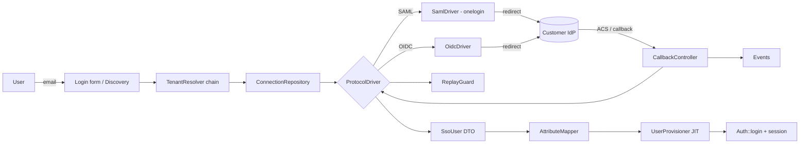

# Gatekeep SSO: Implementation Spec

**Package:** `prestonfoshee/laravel-gatekeep` (namespace `Gatekeep\`). Alternative names: `laravel-tenant-sso`, `laravel-enterprise-sso`. Check that the name is free on Packagist before Phase 0.
**Pitch:** Self-hosted, open-source multi-tenant enterprise SSO (SAML 2.0 + OIDC) for Laravel. An OSS alternative to WorkOS.

---

## How to use this with Cursor

1. Put this file in the repo at `docs/SPEC.md`. Start **one new Cursor chat per phase** and paste that phase's "Prompt for Cursor" block.

2. The agent should only work inside the current phase. Before you move on, run `composer test && composer analyse && composer format -- --test` and get them all green.

3. Commit at the end of every phase (`feat(phase-N): ...`). Open a PR to `main` so CI runs.

4. Add `.cursor/rules/gatekeep.mdc`:
   
   ```md
   
   ```

---

description: Gatekeep package rules
alwaysApply: true

---

- Read docs/SPEC.md first; implement ONLY the phase named in the prompt.

- PHP 8.2+, declare(strict_types=1), final classes by default, readonly value objects.

- Depend on interfaces in src/Contracts; bind in GatekeepServiceProvider.

- Every public behavior gets a Pest test. No network calls in tests (use fixtures/fakes).

- PHPStan level max must pass; no baseline additions without a comment explaining why.

- Never log SAML assertions, tokens, private keys or secrets.

- Do not add dependencies not listed in the spec without asking.

- Finish by running: composer test, composer analyse, composer format.
  
  ```
  
  ```

---

## 1. Overview & goals

- A drop-in package. Each tenant (customer org) configures its own IdP connection(s). End users sign in through their company IdP.
- SAML first (SP-initiated + IdP-initiated), with OIDC behind the same `ProtocolDriver` interface.
- Tenant resolution works on its own (by email domain or subdomain), with an optional stancl/tenancy adapter.
- JIT provisioning, attribute mapping, events, and secrets encrypted at rest.
- Optional Inertia + React admin UI and a demo app (Okta, Entra ID, local Keycloak).
- Quality signals: Pest, PHPStan max, Pint, GitHub Actions matrix, docs site, tagged Packagist releases.

**Target support:** PHP 8.2–8.4 and Laravel 12 / 13. Laravel 13 requires PHP 8.3. Phase 0 dropped Laravel 11: it is end of life, and Composer 2.11 blocks every 11.x release because of security advisories.

## 2. Non-goals (v1)

- Being an IdP. SCIM directory sync is a stretch goal, as is a hosted multi-region service.
- SAML encrypted NameID, artifact binding, and SOAP Single Logout (SLO is HTTP-Redirect only, as a stretch goal).
- Password auth and social login. Those are left to Breeze, Fortify, or Socialite.
- Managing the host app's tenant model. We only reference it by `tenant_key`.

## 3. Library choices (verify versions at Phase 0)

| Concern  | Choice                                                                                    | Notes                                                                                                           |
| -------- | ----------------------------------------------------------------------------------------- | --------------------------------------------------------------------------------------------------------------- |
| SAML     | `onelogin/php-saml` ^4 (SAML-Toolkits)                                                    | Maintained and PHP 8 compatible. Handles signature and XML security validation. Fallback: `litesaml/lightsaml`. |
| OIDC     | `facile-it/php-openid-client` or `jumbojett/openid-connect-php` + `web-token/jwt-library` | Prefer whichever is actively released. We need discovery, PKCE, and JWKS validation.                            |
| HTTP     | Laravel `Http` facade                                                                     | Metadata/discovery fetches. Fakeable.                                                                           |
| Tests    | `pestphp/pest` ^3 (PHP 8.2) or ^4 (Laravel 13), `orchestra/testbench` ^10/^11, `pestphp/pest-plugin-laravel` | Testbench 9 was for Laravel 11 and was dropped with it. |
| Quality  | `larastan/larastan` ^3 (level max), `laravel/pint`                                        |                                                                                                                 |
| Skeleton | Structure from `spatie/package-skeleton-laravel` + `spatie/laravel-package-tools`         |                                                                                                                 |

## 4. Architecture



### Key interfaces (`src/Contracts`)

```php
interface TenantResolver {
    /** Return tenant key or null to let next resolver try. */
    public function resolve(Request $request, ?string $email = null): ?string;
}

interface ConnectionRepository {
    public function find(string $connectionId): ?SsoConnection;
    /** @return Collection<int, SsoConnection> */
    public function forTenant(string $tenantKey): Collection;
    public function forDomain(string $domain): ?SsoConnection;
}

interface ProtocolDriver {
    public function protocol(): Protocol;                       // enum: Saml, Oidc
    public function redirect(SsoConnection $c, LoginIntent $intent): RedirectResponse;
    public function handleCallback(SsoConnection $c, Request $r): SsoUser; // throws SsoException
    public function metadata(SsoConnection $c): ?Response;      // SP metadata (SAML)
}

interface AttributeMapper {
    public function map(SsoConnection $c, array $rawAttributes): MappedAttributes;
}

interface UserProvisioner {
    public function provision(SsoConnection $c, SsoUser $user): Authenticatable;
}

interface ReplayGuard {
    /** Returns false if id already seen; stores until $expiresAt. */
    public function claim(string $connectionId, string $messageId, CarbonImmutable $expiresAt): bool;
}
```

Value objects are `final readonly`: `SsoUser(id, email, firstName, lastName, groups, raw)`, `LoginIntent(returnTo, relayState, forceAuthn)`, `MappedAttributes`. The `Protocol` enum and `SsoException` hierarchy cover `InvalidSignature`, `ReplayDetected`, `ExpiredAssertion`, `AudienceMismatch`, `UnknownConnection`, and `ProvisioningDenied`.

`DriverManager` extends `Illuminate\Support\Manager` so apps can call `Gatekeep::extend('custom', ...)`.

## 5. Data model (migrations)

```php
// sso_connections
$t->ulid('id')->primary();
$t->string('tenant_key')->index();
$t->string('name');
$t->string('protocol');                 // saml|oidc
$t->boolean('enabled')->default(true);
$t->json('domains');                    // ["acme.com"]
$t->text('config');                     // encrypted:array cast (idp entityId, sso url, x509 certs[], oidc issuer, client_id/secret)
$t->json('attribute_map')->nullable();  // {"email":"http://schemas.../emailaddress", ...}
$t->json('provisioning')->nullable();   // {"jit":true,"default_role":"member","allowed_domains":[...],"update_on_login":true}
$t->string('metadata_url')->nullable();
$t->timestamp('metadata_refreshed_at')->nullable();
$t->timestamps();

// sso_connection_domains (unique lookup)
$t->string('domain')->primary();
$t->foreignUlid('sso_connection_id')->constrained()->cascadeOnDelete();
$t->timestamp('verified_at')->nullable();   // DNS TXT verification (stretch)

// sso_identities (link IdP subject -> local user)
$t->id();
$t->foreignUlid('sso_connection_id')->constrained()->cascadeOnDelete();
$t->string('subject');                  // NameID / sub
$t->morphs('user');
$t->timestamp('last_login_at')->nullable();
$t->unique(['sso_connection_id', 'subject']);

// sso_replay_cache
$t->string('key')->primary();           // sha256(connection|messageId)
$t->timestamp('expires_at')->index();

// sso_sp_certificates (SP signing keys, rotation)
$t->id();
$t->foreignUlid('sso_connection_id')->nullable()->constrained()->cascadeOnDelete(); // null = global
$t->text('certificate');
$t->text('private_key');                // encrypted
$t->string('status');                   // next|active|retiring|retired
$t->timestamp('not_after');
$t->timestamps();

// sso_login_attempts (audit)
$t->id(); $t->foreignUlid('sso_connection_id')->nullable(); $t->string('status');
$t->string('error_code')->nullable(); $t->string('ip', 45)->nullable(); $t->timestamps();
```

IdP certs live in `config.x509_certs[]`. Keeping more than one cert allows zero-downtime rotation on the IdP side.

## 6. Config (`config/gatekeep.php`)

```php
return [
    'route_prefix' => 'sso',
    'middleware' => ['web'],
    'user_model' => App\Models\User::class,
    'guard' => 'web',
    'home' => '/dashboard',
    'resolvers' => [ Gatekeep\Resolvers\EmailDomainResolver::class, Gatekeep\Resolvers\SubdomainResolver::class ],
    'subdomain' => ['base_domain' => env('GATEKEEP_BASE_DOMAIN')],
    'saml' => [
        'sp_entity_id' => env('GATEKEEP_SP_ENTITY_ID'), // default: route('gatekeep.saml.metadata', $conn)
        'want_assertions_signed' => true,
        'want_messages_signed' => false,
        'allow_idp_initiated' => false,               // per-connection override
        'clock_skew_seconds' => 120,
        'signature_algorithm' => 'http://www.w3.org/2001/04/xmldsig-more#rsa-sha256',
    ],
    'oidc' => ['scopes' => ['openid','email','profile'], 'use_pkce' => true],
    'provisioning' => ['jit' => true, 'update_on_login' => true, 'provisioner' => Gatekeep\Provisioning\DefaultUserProvisioner::class],
    'replay' => ['store' => 'database'],              // database|cache
    'metadata_refresh' => ['enabled' => true, 'schedule' => 'daily'],
    'audit' => ['enabled' => true],
];
```

## 7. Routes (`routes/gatekeep.php`, prefix `sso`, name `gatekeep.`)

| Method | URI                               | Name            | Purpose                                                      |
| ------ | --------------------------------- | --------------- | ------------------------------------------------------------ |
| POST   | `/sso/discover`                   | `discover`      | Email → resolve connection → redirect (or 422 with "no SSO") |
| GET    | `/sso/{connection}/login`         | `login`         | SP-initiated start                                           |
| GET    | `/sso/saml/{connection}/metadata` | `saml.metadata` | SP metadata XML                                              |
| POST   | `/sso/saml/{connection}/acs`      | `saml.acs`      | Assertion Consumer Service (CSRF-exempt)                     |
| GET    | `/sso/oidc/{connection}/callback` | `oidc.callback` | OIDC redirect URI                                            |
| GET    | `/sso/saml/{connection}/sls`      | `saml.sls`      | Single logout (stretch)                                      |

## 8. Security considerations (each item must be covered by a test)

- **Signatures:** Require a signed assertion (or signed response) and verify it against the configured IdP cert(s). Reject unsigned assertions. Rely on onelogin's XSW protections and add fixture tests for XML signature wrapping attacks and comment-injection NameID attacks.
- **Validation:** Check Audience = SP entityId, Destination/Recipient = ACS URL, NotBefore/NotOnOrAfter with the configured skew, and Issuer = IdP entityId. SP-initiated flows must match InResponseTo against the AuthnRequest ID stored in the session.
- **Replay:** Claim the Assertion ID in `ReplayGuard` until NotOnOrAfter. If the ID was already claimed, throw `ReplayDetected`.
- **IdP-initiated:** Disabled by default and enabled per connection. It has no InResponseTo, so it depends on replay protection plus a short validity window. RelayState is treated as untrusted.
- **Open redirects:** `returnTo`/RelayState may only be relative paths or allow-listed hosts.
- **Secrets:** Use the `encrypted:array` cast. Never log raw XML, tokens, or keys. Logs get a redacted error code only.
- **Account takeover:** Link users by (connection, subject), not by email alone. Only auto-link an existing user by email when the domain belongs to the connection (and has been verified, in the stretch goal).
- **Session:** Call `session()->regenerate()` after login. Rate-limit `discover` and `acs`.
- **XXE / metadata import:** Fetch only over HTTPS, cap the size, disable entity loading, and add SSRF guards (block private IPs).
- **OIDC:** Use `state` + `nonce` + PKCE. Validate `iss`, `aud`, `exp`, and the signature via cached JWKS. Reject `alg=none` and HS* algorithms with a public key.

---

## Phases

### Phase 0: Skeleton, tooling, CI

**Goal:** An empty package that installs, tests, analyses, and lints in CI.

- [ ] Scaffold from spatie skeleton: `composer.json` (PSR-4 `Gatekeep\\`), `GatekeepServiceProvider` via laravel-package-tools

- [ ] Pest + testbench `TestCase`, Larastan level max, Pint (`laravel` preset), composer scripts `test`, `analyse`, `format`

- [ ] `.github/workflows/tests.yml`: matrix PHP 8.2/8.3/8.4 × Laravel 12, plus PHP 8.3/8.4 × Laravel 13, × prefer-lowest/stable; plus `static.yml` (PHPStan + Pint). Laravel 11 was removed after the Phase 0 version check.

- [ ] README stub, LICENSE (MIT), CONTRIBUTING, SECURITY.md, CHANGELOG, `.cursor/rules`
  **Files:** `composer.json`, `src/GatekeepServiceProvider.php`, `tests/TestCase.php`, `tests/Pest.php`, `phpstan.neon.dist`, `pint.json`, `.github/workflows/*`
  **Acceptance:** CI is green on all matrix cells. `composer require` works in a fresh Laravel app via a path repo.
  **Tests:** Arch test (`arch()->expect('Gatekeep')->toUseStrictTypes()`; no `dd`/`dump`), provider boots.
  
  ```text
  Prompt for Cursor: Implement Phase 0 of docs/SPEC.md. Scaffold the package "prestonfoshee/laravel-gatekeep" (namespace Gatekeep) using spatie/laravel-package-tools, Pest 3 + orchestra/testbench, Larastan level max, Pint, and the GitHub Actions matrix described. Add arch tests. Do not implement any SSO logic yet. Finish with composer test/analyse/format all passing.
  ```

### Phase 1: Domain core: models, config, resolvers, contracts

**Goal:** Data layer and tenant resolution, with no protocol logic yet.

- [x] Publishable config + migrations (Section 5, 6)

- [x] Models `SsoConnection` (ULID, encrypted cast, domains sync), `SsoIdentity`, `SpCertificate`, `LoginAttempt`

- [x] Contracts (Section 4), value objects, `Protocol` enum, exception hierarchy

- [x] `EloquentConnectionRepository`; resolvers `EmailDomainResolver`, `SubdomainResolver`, `ChainResolver` (config order)

- [x] `Gatekeep` facade/manager skeleton + `DriverManager` with `extend()`
  **Acceptance:** Given `alice@acme.com`, `forDomain()` returns Acme's enabled connection. Disabled connections are ignored. Domain is unique across connections.
  **Tests:** Encrypted config is unreadable in raw DB. Resolver chain order and fallthrough. Subdomain parsing (`acme.app.test`). Domain normalization (case, IDN/punycode).
  
  ```text
  Prompt for Cursor: Implement Phase 1 of docs/SPEC.md: migrations, config, Eloquent models with encrypted casts, contracts and value objects exactly as specified in Section 4, the connection repository, and the EmailDomain/Subdomain/Chain resolvers. Bind interfaces in the service provider. Full Pest coverage; no SAML code yet.
  ```

### Phase 2: SAML SP-initiated login

**Goal:** End-to-end SP-initiated SAML login against fixtures.

- [x] `SamlDriver` wrapping onelogin `Auth`/`Settings` built per connection (`SamlSettingsFactory`)

- [x] SP metadata endpoint (signed if SP cert exists); AuthnRequest redirect (HTTP-Redirect binding), store request ID in session

- [x] ACS controller: validate response (Section 8), InResponseTo, build `SsoUser`

- [x] `DatabaseReplayGuard` + `CacheReplayGuard`; scheduled prune command `gatekeep:prune`

- [x] `/sso/discover` + `/sso/{connection}/login`; CSRF exemption for ACS; rate limiters

- [x] Test fixture generator: `tests/Support/SamlResponseFactory` that signs responses with a test key (use robrichards/xmlseclibs, already a onelogin dep)
  **Acceptance:** A signed fixture response logs the user in (with stub provisioner). All negative cases return a 4xx with an error code and write a `LoginAttempt` row.
  **Tests (required):** valid login; unsigned → reject; wrong cert; tampered NameID after signing; XSW wrapped assertion; expired; not-yet-valid outside skew; wrong audience; wrong destination; InResponseTo mismatch; replayed assertion; open-redirect RelayState sanitized; metadata XML validates against the SAML metadata schema (or at least contains entityID, ACS, cert).
  
  ```text
  Prompt for Cursor: Implement Phase 2 of docs/SPEC.md: SamlDriver using onelogin/php-saml v4, per-connection settings factory, SP metadata, SP-initiated redirect, ACS with every validation in Section 8, replay guards and prune command, discovery route. Build tests/Support/SamlResponseFactory to generate signed fixtures with a test keypair and write every negative test listed. No real network calls.
  ```

### Phase 3: IdP-initiated login, metadata import, cert rotation

- [x] Per-connection `allow_idp_initiated`; ACS accepts unsolicited responses only when enabled

- [x] `MetadataImporter`: parse XML upload or HTTPS URL (SSRF guard, size cap, no XXE) → entityId, SSO URL, certs[]

- [x] `gatekeep:refresh-metadata` command + scheduler hook; fire `IdpMetadataRefreshed`/`IdpCertificateChanged`

- [x] IdP multi-cert validation (any configured cert valid)

- [x] SP cert rotation: `gatekeep:sp-cert:generate|promote|retire`; metadata publishes active + next certs
  **Acceptance:** Rotating the IdP cert using an overlapping cert pair causes zero failed logins. IdP-initiated login is rejected by default.
  **Tests:** IdP-initiated on/off; import from Okta + Entra sample metadata fixtures; private-IP URL rejected; XXE payload rejected; signature valid with old or new cert during overlap; SP metadata contains 2 certs while one is `next`.
  
  ```text
  Prompt for Cursor: Implement Phase 3 of docs/SPEC.md: IdP-initiated SAML (off by default), MetadataImporter (upload + URL with SSRF/XXE/size guards), refresh command and events, multi-cert IdP validation, and SP certificate rotation commands. Use the Okta and Entra metadata XML fixtures in tests/fixtures. Tests for every acceptance criterion.
  ```

### Phase 4: JIT provisioning, attribute mapping, events

- [ ] `ConfigurableAttributeMapper` with presets: `okta`, `entra` (schemas.xmlsoap claim URIs), `google`, `generic`

- [ ] `DefaultUserProvisioner`: find via `SsoIdentity` → else safe email-link (Section 8) → else create (if JIT); update on login; `HasSsoIdentities` trait for user model

- [ ] Group → role mapping hook (`Gatekeep::mapGroupsUsing(fn)`)

- [ ] Events: `SsoLoginAttempting`, `SsoLoginSucceeded`, `SsoLoginFailed`, `SsoUserProvisioned`, `SsoUserUpdated`

- [ ] Login: `Auth::guard()->login()`, session regenerate, redirect intended/home
  **Acceptance:** First login creates user + identity. Second login updates names. A user from a foreign domain is never linked by email. JIT off + unknown user → `ProvisioningDenied`.
  **Tests:** Each preset maps fixture attributes. Events dispatched with payloads (no raw assertion). Custom provisioner binding is respected.
  
  ```text
  Prompt for Cursor: Implement Phase 4 of docs/SPEC.md: attribute mapper with okta/entra/google/generic presets, DefaultUserProvisioner with the safe-linking rules from Section 8, HasSsoIdentities trait, group mapping hook, all events, and the final login step. Test every acceptance criterion.
  ```

### Phase 5: OIDC driver

- [ ] `OidcDriver` implementing `ProtocolDriver`: discovery (`.well-known`), auth code + PKCE, state/nonce in session, token exchange, ID token validation via cached JWKS, userinfo merge

- [ ] Connection config schema per protocol (FormRequest-style validator `ConnectionConfigValidator`)

- [ ] Mapper presets reused (claims `email`, `given_name`, `family_name`, `groups`)
  **Acceptance:** The same discovery → login → provisioning flow works for an OIDC connection without changes outside the driver. This proves the abstraction.
  **Tests:** `Http::fake` discovery/JWKS/token; reject bad state, nonce mismatch, wrong iss/aud, expired, `alg=none`, unknown kid (triggers one JWKS refresh then fails).
  
  ```text
  Prompt for Cursor: Implement Phase 5 of docs/SPEC.md: OidcDriver (discovery, PKCE, state/nonce, JWKS-cached ID token validation) behind the existing ProtocolDriver interface, plus the per-protocol config validator. No changes to controllers or provisioning should be needed; if they are, explain why. Http::fake all network calls and cover each rejection case.
  ```

### Phase 6: stancl/tenancy adapter + login form integration

- [ ] `Gatekeep\Integrations\Stancl\StanclTenantResolver` (suggest dep only; guarded by `class_exists`); docs for central vs tenant routes

- [ ] Blade component `<x-gatekeep::sso-button />` and JS-free discovery form; `Gatekeep::routes()` helper; middleware `RedirectIfSsoRequired` (force SSO for enforced domains when password login is attempted)
  **Acceptance:** In a testbench app with stancl installed (dev dep), resolution uses the current tenant. Password login for an enforced domain redirects to SSO.
  
  ```text
  Prompt for Cursor: Implement Phase 6 of docs/SPEC.md: optional stancl/tenancy resolver (dev dependency for tests only, suggest in composer.json), Blade SSO components, discovery form, and RedirectIfSsoRequired middleware. Tests included.
  ```

### Phase 7: Admin UI (separate optional package `laravel-gatekeep-admin`)

- [ ] Inertia + React + TypeScript pages: connections list, create/edit (SAML/OIDC tabs), metadata upload/URL import, show SP metadata/ACS URL to copy, attribute-map editor, test-connection button, login attempts log

- [ ] Authorization via `Gate::define('manageSso', ...)`; tenant-scoped

- [ ] Vite build shipped as prebuilt assets; Pest feature tests for controllers; Vitest + Testing Library for 2–3 key components
  **Acceptance:** A tenant admin can configure Okta end-to-end through the UI without editing the DB.
  
  ```text
  Prompt for Cursor: Implement Phase 7 of docs/SPEC.md as a separate package in packages/admin: Inertia + React + TS admin UI for connections, metadata import, attribute mapping, test connection and audit log, authorized by the manageSso gate and tenant-scoped. Feature tests for controllers and Vitest tests for the connection form.
  ```

### Phase 8: Demo app + local IdP

- [ ] `demo/` Laravel app (Breeze React) with two seeded tenants: `acme.test` → Keycloak SAML, `globex.test` → Keycloak OIDC; docs for Okta dev + Entra free tenant

- [ ] `docker-compose.yml`: app, Postgres, Keycloak with realm export (`demo/keycloak/realm.json`) auto-imported

- [ ] Playwright (or Laravel Dusk) E2E: log in via Keycloak SAML and OIDC in CI using a services container
  **Acceptance:** `docker compose up` followed by login through Keycloak works in under 5 minutes from clone. The E2E job is green in CI.
  
  ```text
  Prompt for Cursor: Implement Phase 8 of docs/SPEC.md: demo Laravel app using the package via path repo, docker-compose with Keycloak auto-importing a realm with one SAML and one OIDC client, seeders for two tenants, and a Playwright E2E workflow in GitHub Actions.
  ```

### Phase 9: Docs, hardening, release

- [ ] Docs site (VitePress in `docs/`, deployed to GitHub Pages): install, quick start, Okta guide, Entra guide, Keycloak, custom resolvers/drivers, security model, upgrade guide

- [ ] Coverage ≥ 90% (Pest `--coverage --min=90`), mutation testing (`pest --mutate`) on validators

- [ ] Security self-review against the Section 8 checklist; `SECURITY.md` disclosure policy

- [ ] Tag `v1.0.0`, Packagist auto-update webhook, release notes via release-please or changelog action; badges
  **Acceptance:** `composer require prestonfoshee/laravel-gatekeep` works from Packagist. The docs are live, and the README has badges for CI, coverage, PHPStan, and version.
  
  ```text
  Prompt for Cursor: Implement Phase 9 of docs/SPEC.md: VitePress docs with the listed guides, coverage gate at 90%, mutation testing on security validators, release workflow, and README badges. Produce a security checklist doc mapping each Section 8 item to the test that covers it.
  ```

---

## Stretch goals

- SAML Single Logout (HTTP-Redirect) and OIDC RP-initiated logout
- SCIM 2.0 provisioning endpoint (Users/Groups) for Okta/Entra
- Domain verification via DNS TXT record
- Per-connection health dashboard + cert expiry alerts (notifications 30/7/1 days)
- OpenTelemetry spans for login flow; Pulse card
- Encrypted assertions; Laravel Passport/Sanctum token issuance after SSO

## Resume & GitHub presentation

**README outline:** banner + one-line pitch → badges → "Why" (WorkOS-like SSO, self-hosted) → 60-second quick start → feature matrix (SAML/OIDC/IdP-initiated/JIT/rotation) → architecture mermaid → security model link → demo GIF (Keycloak login) → provider guides → extending (custom resolver/driver) → testing & contributing → license.

**Repo polish:** topics (`laravel`, `saml`, `oidc`, `sso`, `multi-tenant`), issue templates, Discussions, a pinned "Roadmap" issue, conventional commits, signed tags.

**Sample resume bullets (fill in the metrics):**

- Built and open-sourced **Gatekeep**, a multi-tenant enterprise SSO package for Laravel (SAML 2.0 + OIDC), giving teams a self-hosted alternative to WorkOS; [X] Packagist installs, [Y] GitHub stars.
- Designed a pluggable protocol-driver and tenant-resolver architecture that let me add OIDC with **zero changes** to the controller and provisioning layers.
- Hardened SAML processing against signature wrapping, replay, and open-redirect attacks, backed by [N] security regression tests; [Z]% coverage, PHPStan level max, CI across [M] PHP/Laravel combinations.
- Implemented zero-downtime IdP/SP certificate rotation and scheduled metadata refresh, plus JIT user provisioning with Okta/Entra attribute presets.
- Shipped an Inertia + React admin UI and a Dockerized Keycloak demo that runs end-to-end Playwright tests in CI.
